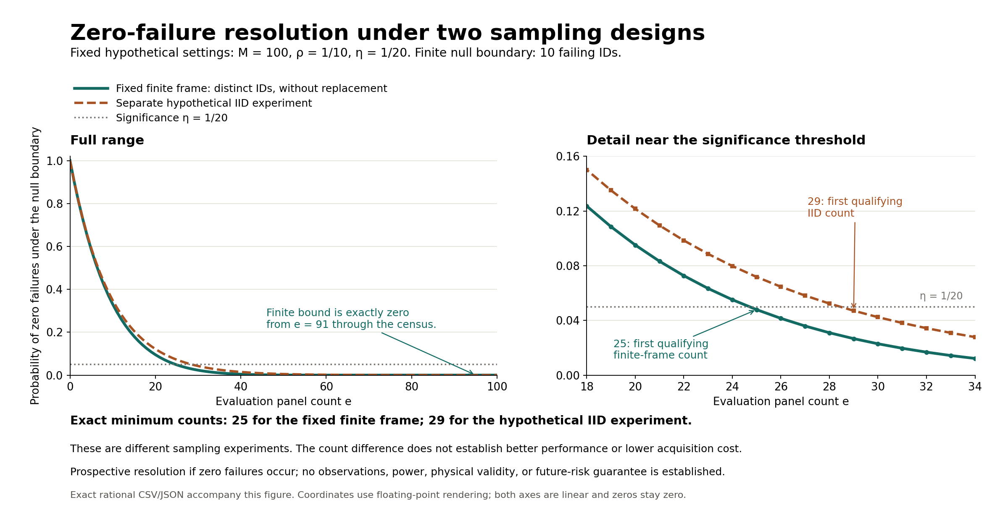

# Finite-frame and IID zero-failure resolution: exact hypothetical figure

Publication navigation revision: the two CSV/SVG links below point to the equivalent
clean exports. The exact original author README is retained in `README.md.bytes.json`;
its original hashes and chronology are unchanged. See [publication mapping](PUBLICATION.md).



The [PNG](second-generation/finite-versus-iid.png) and
[SVG](finite-versus-iid.svg) show a full linear curve and a
threshold detail for fixed hypothetical settings `M=100`, `rho=1/10`, and
`eta=1/20`. The [exact JSON](second-generation/exact-data.json) and
[exact CSV](exact-data.csv) retain all 101 rational values
for `e=0,...,100`. Rendering alone converts those values to floating-point
coordinates. No rounded probability is presented as an exact table value,
no logarithmic axis is used, and exact zero is plotted as zero.

These curves describe **two different sampling experiments**:

- For the finite curve, a complete residual frame contains 100 distinct panel
  IDs after policy/calibration freeze. Endpoints are fixed, and evaluation
  draws distinct IDs uniformly without replacement. The null is that at
  least one tenth of the frame fails, so its least attainable failure count
  is ten. The zero-failure probability is maximized at that count.
- For the separate IID curve, hypothetical failures are independent with a
  common probability conditional on the frozen rule. The null is a common
  failure probability of at least one tenth. Its zero-failure probability is
  maximized at the null boundary `q=1/10`.

The finite experiment first meets `bound <= 1/20` at **25** panels; the IID
experiment first meets it at **29**. The count difference is a consequence
of different sampling models and claim scopes. It is not observed evidence
of better recommendations, lower acquisition cost, stronger future-risk
control, or statistical power. Neither sampling premise is established here.
Both numbers describe prospective resolution **if zero failures occur**.
No outcomes, scientific data, fit, allocation or acquisition are used.

## Independent construction

The generator imports no Lupine runtime module. It uses exact `Fraction`
arithmetic and a sequential-draw recurrence independent of the runtime's
combination-ratio implementation. Start with `G_0=1`. Given that the first
`e-1` draws are nonfailures, there are `90-e+1` nonfailures among `100-e+1`
remaining IDs, giving

\[
G_e = G_{e-1}\frac{90-e+1}{100-e+1},\qquad 1\le e\le90.
\]

For `e=91,...,100`, zero failures is impossible under the finite null and
`G_e=0` exactly. This is an event probability under a null model, not an
observation that a material or policy has zero risk. The separate IID
recurrence is `H_0=1`, `H_e=(9/10)H_{e-1}`, which stays positive through
the displayed range. Exact comparisons, rather than rounded coordinates,
determine both first qualifying counts.

The finite count at the boundary is
`G_25 = 655281507/13684039096`. The IID boundary value is
`H_29 = 4710128697246244834921603689/100000000000000000000000000000`.
The complete table retains the adjacent counts needed to verify minimality.
The finite probability averages over the evaluation draw conditional on the
fixed policy/calibration/frame, not additionally on its realized subset.
The figure is original explanatory arithmetic, not a new theorem compilation,
formal Python refinement or scientific experiment.

## Generation and retained evidence

`generate.py` is the reproducible script. From `discovery/`, its actual final
invocation was:

```sh
python .cache/phase2-finite-planning-figure-v1/generate.py \
  --output-directory .cache/phase2-finite-planning-figure-v1/second-generation
```

It requires the already available Matplotlib and a fresh output directory
inside its own figure directory. No dependency installation occurred. To run
a further reproduction, use another new output name rather than overwrite
the retained generations. The script can also live directly in the analogous
`discovery/reports/` report directory; its source bindings resolve relative
to `discovery/` in either location.

The first render completed in 1.117149 seconds. Visual inspection found one
annotation overlapping the finite curve, so the second render moved that
annotation only and completed in 1.975853 seconds. Both succeeded; the first
script, images, exact data and execution receipt remain unchanged in
`first-generation/`. The second script is also snapshotted beside its outputs.
Exact CSV, JSON and source bindings are byte-identical across the two renders.

The execution receipts record Python 3.12.14, Matplotlib 3.10.8, actual commands,
timestamps, script hashes, artifact hashes and held source identities. Both
runs preserved clean HEAD `4492858d9e55ddfa3cca2e208063799517948b13` and both
bound planner sources. `source-bindings.json` is an identity record for later
runtime conformance checking; the generator itself did not import or execute
the planners and does not claim conformance verification. A later independent
review, if performed, belongs in its own actual record. Hashes attest byte
identity, not scientific validity or sampling assumptions.
