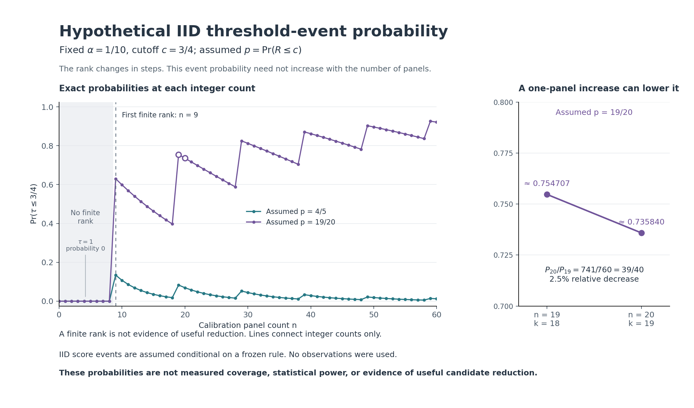

# Hypothetical prospective-planning figure

This figure explains why the workbench evaluates a specified calibration count,
without assuming a monotone minimum-count search. It uses the existing exact
planner for two fixed hypothetical IID score laws, with **alpha = 1/10**,
**cutoff = 3/4**, **n = 0..60**, and **p = 4/5 or 19/20**. There is no dataset,
fitting, empirical parameter choice, observed coverage or scientific experiment.



The event is `tau <= 3/4`; the assumed probability is `p = Pr(R <= 3/4)`.
With `k = ceil((n+1)*9/10)`, the first finite order-statistic rank is **n = 9**.
For n = 0..8, the existing bounded-score pool rule instead sets tau = 1, so this
event has probability zero deterministically, without needing the IID premise.
This does not provide a calibrated guarantee. For finite rank, the plotted
binomial probability assumes IID score events conditional on a frozen scoring
rule and fixed scope. Exchangeability alone does not provide that calculation.

For p = 19/20, the n = 19 and n = 20 ranks are 18 and 19. Exact arithmetic gives:

- `P19 = 2*(19/20)^19`.
- `P20 = (39/20)*(19/20)^19`.
- `P20/P19 = 741/760 = 39/40`: a **2.5% relative decrease**, not a decrease of
  2.5 percentage points.

The rank changes discretely. A larger count therefore need not increase this
threshold-event probability. The contrast does not prohibit a separately
specified exhaustive count search; it rejects an unsupported monotonicity
assumption. Finite rank alone does not establish useful pool reduction. These
probabilities are neither measured coverage nor statistical power, and do not
attest independence, physical validity or scientific superiority. If p is not
supplied, finite-rank event probabilities remain unknown; neither hypothetical
curve estimates p from observations.

## Artifacts and reproduction

- `exact-values.json`: all **122** records as integers and reduced rational
  strings, their assumptions/statuses and the exact n19-to-n20 contrast.
- `exact-values.csv`: the same records; an empty tolerated-above-cutoff field
  means null for an infeasible rank, not zero. Boolean fields use True/False.
- `prospective-threshold-probability.svg` and `.png`: standalone figures.
  The right panel is a detail with a narrower 0.70–0.80 y-axis.
  Connecting lines are visual guides between integer counts. Plot coordinates
  and the six-decimal annotations are rounded floating-point displays only;
  full exact rationals remain in JSON/CSV.
- `make_figure.py`: fixed, dataset-free generator. It calls the existing planner
  rather than duplicating the rank or binomial implementation, and requires the
  recorded planner hash. Float conversion occurs only in rendering code.
- `source-bindings.json`: planner, calibration/core dependencies, generator
  identity and Python/Matplotlib versions.
- `generation.json`, `stdout.log`, `stderr.log`: actual generation command and
  source-before/after receipt. Exit zero means artifacts were generated, not a
  new runtime-test pass or scientific result.
- `first-generation/` and `second-generation/`: earlier successful generations
  retained before presentation-only legend placement and approximation-symbol
  adjustments. The final CSV/JSON bytes match the second generation exactly.

From `discovery/`, keep this directory under `.cache/phase2-planning-figure-v1/`
and run:

```sh
python .cache/phase2-planning-figure-v1/make_figure.py
```

The existing Python environment must already provide Matplotlib; no dependency
installation was performed for this task. The script writes its artifacts and
Matplotlib configuration cache beside itself. It reads only the planner source
and dependencies; it opens no scientific input file or network resource.

No runtime, API, interface, archive, protocol or scientific claim was changed.
